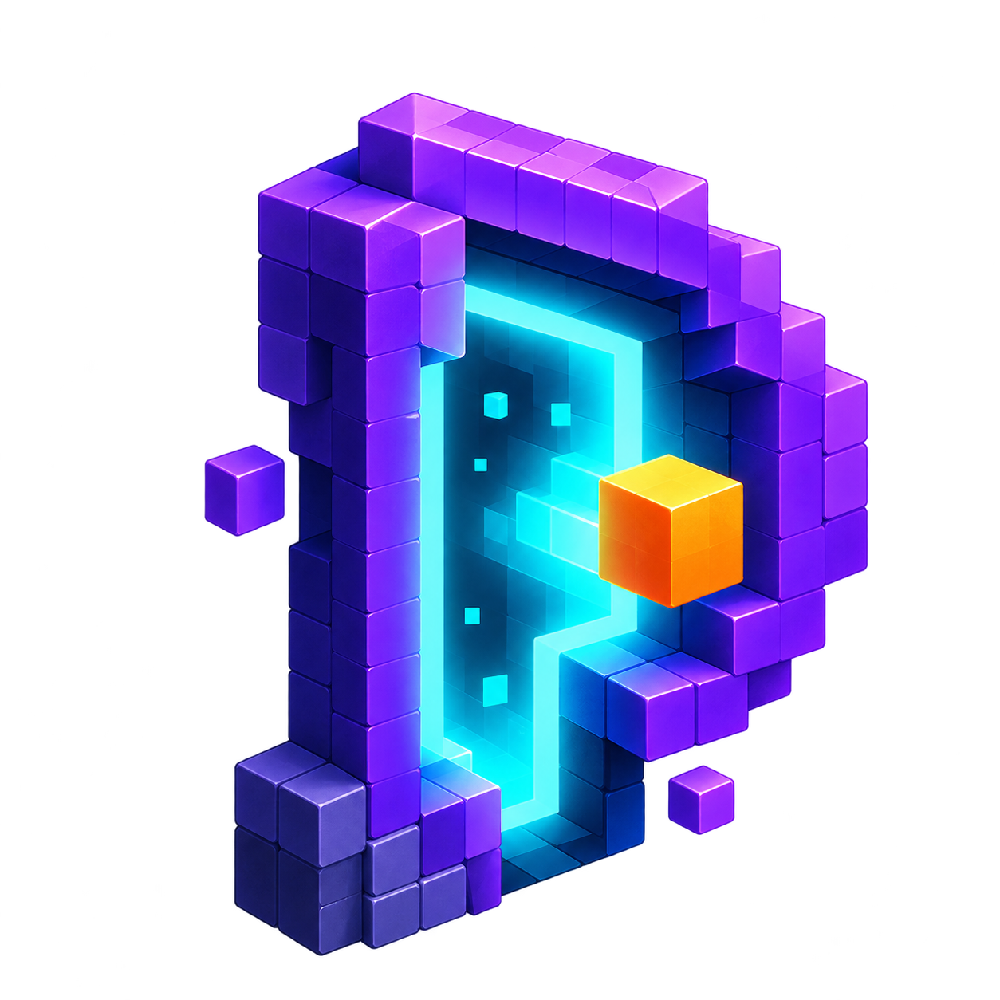

  

# ParallelEarth — Git Worktree Experiments for VS Code

**Try alternative implementations. Run matching checks. Compare evidence before choosing your next change.**

ParallelEarth is a local **VS Code extension for Git worktree management, code experiments and baseline comparison**. Create separate working directories called *Earths* from a committed revision, edit each approach in its own editor window, and compare the test or build commands you approve.

Explore refactoring approaches, investigate bug fixes and compare implementations without replacing the working files in your original checkout. No AI account, API key, telemetry or cloud backend is required.

> **Release status:** v0.1.0 development build. Not yet published to the Visual Studio Marketplace or Open VSX. Windows-focused checks have passed; full release validation, Windows cancellation verification and macOS/Linux verification remain outstanding. See [validation status](docs/validation.md).

[Quick start](#quick-start-create-your-first-code-experiment) · [Features](#git-worktree-and-code-comparison-features) · [Installation](#installation) · [FAQ](#frequently-asked-questions) · [Documentation](#documentation)

## What is ParallelEarth?

ParallelEarth organizes parallel development around three concepts:

| Concept | Purpose |
| --- | --- |
| **Experiment** | A named investigation attached to your Git repository and an exact committed revision. |
| **Baseline Earth** | A reference worktree created from that revision for running comparison checks. |
| **Alternative Earth** | A separate detached Git worktree where you try another implementation. |

For example, create an experiment for a slow checkout calculation. Run its existing tests on the baseline, try another implementation in an alternative Earth, then compare command results and inspect the code changes.

A successful command means it returned zero. It does not prove application correctness or establish that an implementation is faster; performance claims need appropriate benchmarks.

## When to use parallel code experiments

- **Compare refactoring approaches:** try two designs from the same committed starting point.
- **Investigate bug fixes:** keep the reference implementation available while testing an alternative.
- **Evaluate code changes:** inspect tracked diffs and identify untracked files before deciding what to keep.
- **Compare test and build results:** run matching checks against the baseline and alternatives.
- **Resume investigations:** return to an existing experiment through project history.

Earths can contain projects in different languages because the working-directory mechanism uses Git. Built-in check discovery currently targets npm scripts and Node test files; other language-specific test runners are not automatically integrated.

## Git worktree and code comparison features

- **Committed baselines:** pin experiments to an exact Git revision.
- **Separate working directories:** create detached worktrees outside the source repository.
- **Readable Earth names:** identify the project and alternative in folder names and editor windows.
- **Earth management:** rename, archive, unarchive and duplicate alternatives from the committed baseline.
- **Change inspection:** inspect tracked changes and untracked filenames; preview and approve supported text patches.
- **Approved checks:** discover npm test, build, lint, typecheck and check scripts, or select a Node test file.
- **Execution evidence:** record command exit results, bounded output and run identifiers.
- **Baseline comparison:** compare matching checks and export JSON or Markdown reports.
- **Persistent project history:** search and sort compact project rows, with six projects per page.
- **Conservative cleanup:** retain Earth files while removing history, or remove eligible clean worktrees.
- **Local interface:** branded home, native Explorer views and a Pixel Portal animation with reduced-motion support.

Reports use the latest check per Earth; JSON retains up to 50 runs per Earth. Individual assertions remain in command output rather than normalized test-result records. Mismatched check fingerprints are inconclusive.

## Installation

### Current development build: install from VSIX

1. Obtain a reviewed ParallelEarth VSIX. When building this repository locally, the package is written to <code>artifacts/parallel-earth-0.1.0.vsix</code>.
2. In VS Code, open **Extensions** and select the **…** menu.
3. Choose **Install from VSIX…** and select the package.
4. Reload the editor if prompted.
5. Run **ParallelEarth: Open Home** from the Command Palette.

There is no live Marketplace installation link yet. Publication is planned for the Visual Studio Marketplace and Open VSX after release validation.

### Requirements and editor compatibility

| Requirement | Current scope |
| --- | --- |
| Editor | VS Code 1.100 or later; see the manifest for the declared minimum. |
| Project | A trusted local Git repository with at least one commit. |
| Tools | Git available to the extension; Node.js/npm for Node-based checks and development. |
| Operating systems | Windows-focused checks completed; macOS and Linux verification pending. |
| Cursor and VSCodium | Intended compatibility targets; clean-install validation remains pending. |
| Browser-only editors | Unsupported by this local Node.js extension. |
| JetBrains and other IDE families | Require separate integrations; the VSIX is not a universal IDE plugin. |

## Quick start: create your first code experiment

1. **Choose your project.** Open ParallelEarth Home and click **Create Experiment**. Select your own Git repository.
2. **Name the experiment.** Use a descriptive name such as “Checkout calculation refactor” and select a committed baseline.
3. **Create an alternative Earth.** Give the approach a readable name.
4. **Open Earth.** Edit its separate working directory in a new editor window.
5. **Run matching checks.** Approve the exact commands for the baseline and alternatives.
6. **Compare evidence.** Select **Compare Earths**, inspect changes and export a report.
7. **Keep or clean up.** Archive the work, retain its files while removing history, or delete eligible clean worktrees.

No project or experiment is created automatically. The Active Experiment view stays empty until you create or resume an experiment.

Uncommitted changes, untracked files and ignored files in the source checkout are excluded from the committed baseline. Dependencies are not installed automatically. Duplicating an Earth starts from its original committed baseline and does not copy its edits.

## Project history and deletion

Previous projects are grouped in **Project History**. Home provides search, sorting and pagination so the list stays manageable as your projects grow. Resume an experiment from history or close the active experiment without deleting it.

**Delete Experiment** offers two confirmed actions:

| Action | Result |
| --- | --- |
| **Remove from History** | Removes the catalog entry and retains Earth files. |
| **Delete Clean Worktrees** | Checks ownership and cleanliness before removing the experiment's worktrees. Edits, ignored/untracked files and new commits block cleanup. |

The original source repository is not a deletion target. Individual baseline deletion is refused; deleting an entire experiment can remove its clean baseline together with its alternatives. Interrupted creation attempts are excluded from normal history and remain available through the deletion picker for cleanup.

## Frequently asked questions

### How is ParallelEarth different from switching Git branches?

Switching branches changes the checkout in a working directory. Git worktrees provide additional working directories. ParallelEarth adds named experiments, a baseline, approved checks, history and comparison reports around detached worktrees.

### Can I compare two implementations side by side?

Yes. Create alternative Earths from the same experiment, open their working directories, run matching checks and inspect the differences. Comparison quality depends on the checks you choose.

### Does ParallelEarth merge an experiment into my main project?

No automatic merge or patch transfer back to the source checkout is performed. Review the alternative's changes and use your normal Git workflow to bring the chosen changes back.

### Can I use ParallelEarth with AI coding tools?

You can edit an Earth using tools available in its editor window. ParallelEarth does not generate code or require an AI provider. Git worktrees separate checkout state; they do not prevent a tool or command from accessing other files on your machine.

### Does it upload my source code?

ParallelEarth does not upload source code or include telemetry or a cloud backend. Commands and tools you choose to run can have their own network behaviour.

### Is an Earth a secure sandbox?

No. An Earth is a Git worktree, not a container or security boundary. Approved scripts can access your machine, credentials and network. Use trusted projects and commands.

### Does installing it install my project's dependencies?

No. Install dependencies deliberately in the appropriate working directory when your project needs them.

## Security and limitations

Workspace Trust and per-command approval apply to execution. Git hooks and external diff/textconv are disabled by extension Git operations, but repository checkout filters remain a trust risk.

The runner includes cancellation, timeouts, bounded logs and concurrency controls; Windows process-tree cancellation remains a release-validation item. A reduced execution environment does not prevent access to credentials on disk. Logs and reports may contain sensitive information.

The home Webview uses a restrictive nonce CSP, local asset roots, escaped project data and a validated message allowlist. No automatic dependency installation, cleanup, merge, reset or stash is performed.

Container isolation, AI generation, normalized test results and static import blast-radius estimates are outside the current release scope. See the [security model](docs/security-model.md) and [experiment isolation guide](docs/experiment-isolation.md).

## Development

Development requires Node.js 22.17 or later, npm, Git and VS Code 1.100 or later.

~~~powershell
npm install
npm run typecheck
npm test
npm run package
npm run test:host
~~~

Press **F5** to launch an Extension Development Host with an explicit empty ParallelEarth workspace. Development startup does not seed experiments or open a demo project.

Core tests use Node's built-in test runner and no runtime package dependencies. The build can reuse globally installed TypeScript when local installation is unavailable; semantic typechecking runs separately.

The current offline VSIX packager uses an explicit file allowlist. A reviewed dependency lockfile, official vsce packaging validation, clean-profile installation and the remaining release gates are required before publication. The configured publisher ID is not proof of registry ownership.

### Optional booking comparison demo

Run <code>npm run demo</code> to create a separate fixture repository, baseline and three alternatives. This is an explicit development command and is not part of startup.

The fixture demonstrates passing baseline/Earth A checks, an intentionally failing duplicate-booking calculation in Earth B, and an unexecuted Earth C. JSON/Markdown reports are written to <code>artifacts</code>; fixture worktrees remain available for inspection.

## Documentation

- [Getting started](docs/getting-started.md)
- [Architecture](docs/architecture.md)
- [Experiment isolation](docs/experiment-isolation.md)
- [Security model](docs/security-model.md)
- [Troubleshooting](docs/troubleshooting.md)
- [Validation status](docs/validation.md)
- [Publishing checklist](docs/publishing.md)
- [Contributing](CONTRIBUTING.md)
- [Changelog](CHANGELOG.md)

## License

ParallelEarth is available under the [MIT License](LICENSE).

